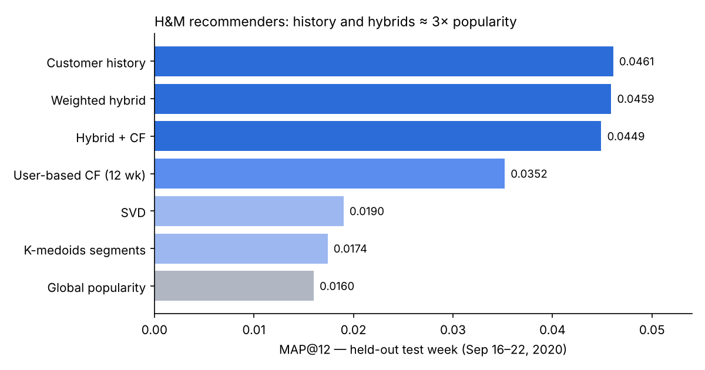

# Hybrid Fashion Recommender — H&M

End-to-end recommender system on Kaggle's **H&M Personalized Fashion Recommendations** data (31.8 M transactions, 1.37 M customers, 105 k articles). It combines unsupervised customer segmentation with eight recommenders and a rank-fusion hybrid, evaluated with a strict **temporal hold-out**.

> 🇪🇸 *Sistema de recomendación híbrido sobre los datos de H&M: muestreo estratificado, segmentación no supervisada, ocho recomendadores y fusión por rango, con validación temporal. El notebook está en español.*



## Key findings

- **Repurchase history is the strongest signal.** The customer's own purchase history reaches MAP@12 = 0.0461 on the test week, almost 3× global popularity (0.0160).
- **The hybrid ties history, it does not beat it.** The weighted hybrid scores 0.0459 (difference −0.0001, 95 % CI −0.0017 to 0.0016). Its +0.0021 edge on the validation week did not replicate, which exposes optimistic bias from tuning weights on the same week.
- **Recency beats sophistication.** Restricting collaborative filtering to the last 12 weeks improved it by 41 %. Popularity-driven models lost 11–19 % between validation and test, while history-based models stayed within ±3.4 %.
- **Segmentation describes but does not recommend.** K-medoids gave the most interpretable segments (by product line), yet their lift over popularity was not significant. Content-based TF-IDF and RBM underperformed popularity.

## Method

| Step | What was done |
|---|---|
| Sampling | Proportional **stratified sample of 10 % of customers** (activity level × age group), validated with Monte Carlo against alternative designs. Self-weighting: weights 9.98–10.01 |
| Temporal split | Train ≤ Sep 8, 2020 · validation Sep 9–15 · test Sep 16–22 (≈ 6.9 k evaluated buyers) |
| Unit | `product_code` (colour variants merged): 105,542 articles → 47,224 products |
| Profiles | 22 behavioural features → PCA (9 components, 73.6 % variance) |
| Segmentation | K-means, K-medoids (CLARA), Ward hierarchical, Gaussian mixtures, DBSCAN |
| Recommenders | Popularity, customer history, segment popularity, Apriori rules, user-based CF (cosine), SVD, content-based TF-IDF, Bernoulli RBM |
| Hybrid | Reciprocal rank fusion with weights tuned on the validation week |
| Evaluation | Precision@12, Recall@12, MAP@12, paired bootstrap confidence intervals (2,000 resamples of customers), analysis by activity level and by hit origin (repurchase vs. new product) |

## Repository

```
├── hm_hybrid_recommender.ipynb   # full analysis (Spanish)
├── figures/
├── requirements.txt
└── README.md
```

The notebook is shown without re-executed outputs because it needs ~3 GB of Kaggle data. The figures and numbers above are copied from the written analysis in each section.

## How to run

1. Accept the competition rules on [Kaggle](https://www.kaggle.com/competitions/h-and-m-personalized-fashion-recommendations) and create an API token.
2. In Google Colab, store it as a secret named `KAGGLE_API_TOKEN` (never paste it into the notebook).
3. `pip install -r requirements.txt` and run the notebook top to bottom. A GPU runtime is recommended for section 11 (image embeddings).

## Limitations

A single test week; product-level evaluation counts a repurchase in another colour as a hit; the fusion constant was fixed at 60 without tuning. Section 11 (CLIP image embeddings) is an exploratory extension still in progress.

## Stack

Python · pandas · DuckDB · PyArrow · scikit-learn · kmedoids · apyori · SciPy · PyTorch + Hugging Face Transformers (CLIP) · matplotlib

**Author:** Mateo Aranguren
